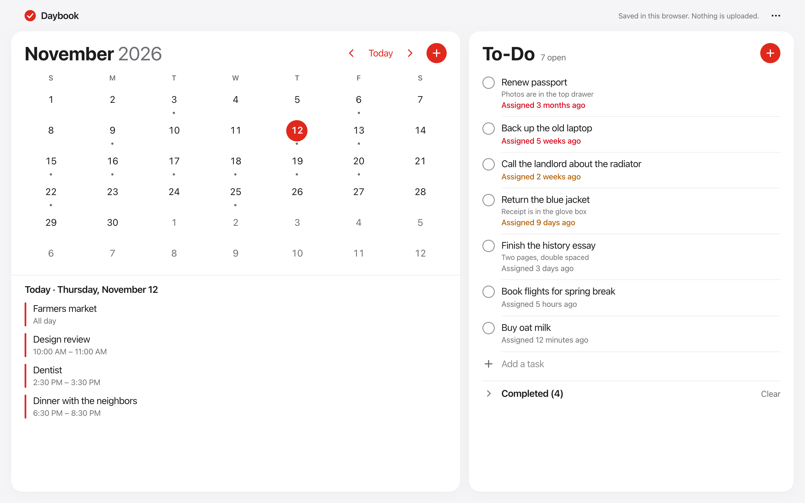
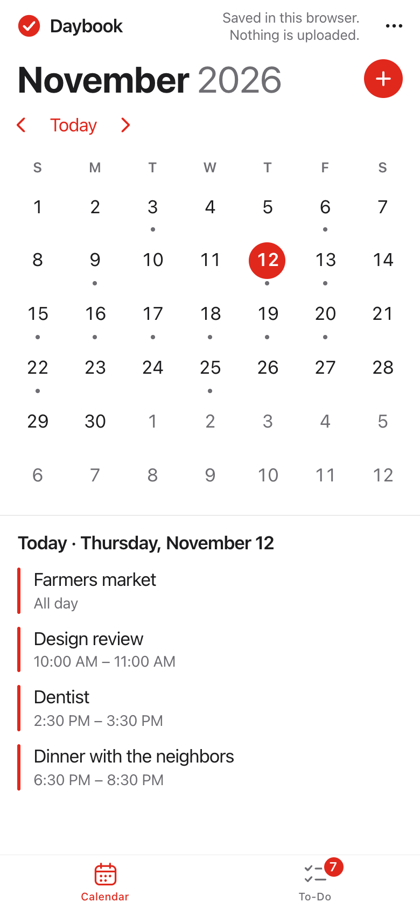
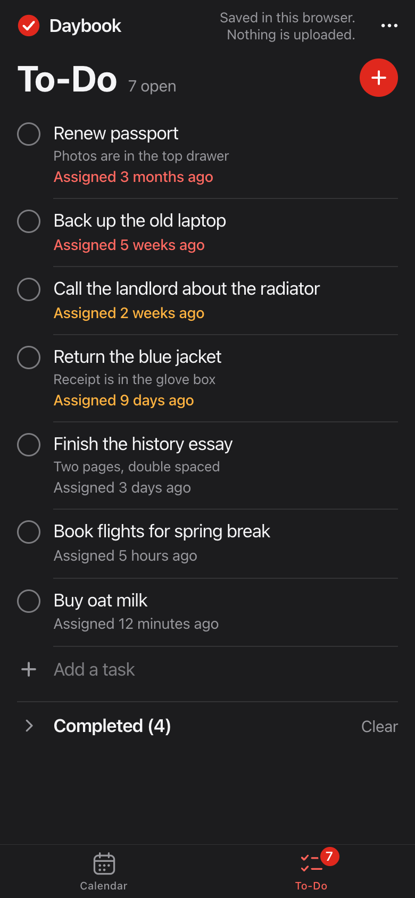
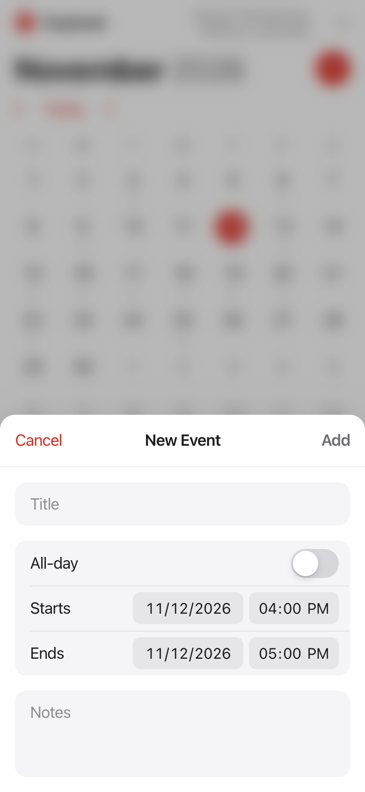
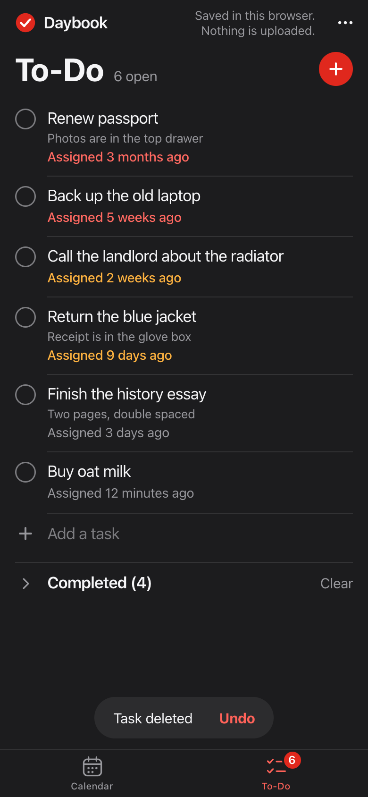
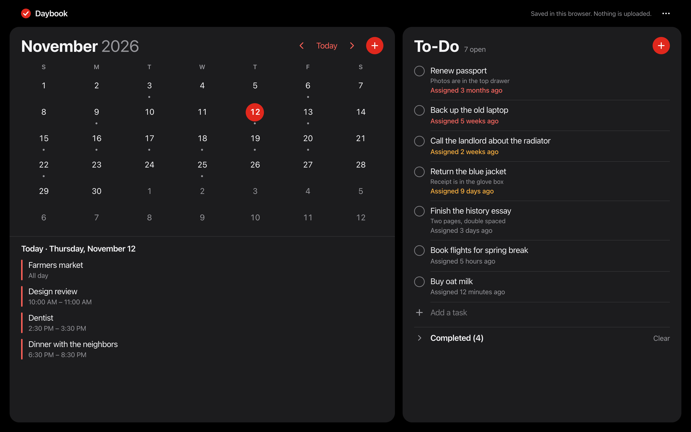
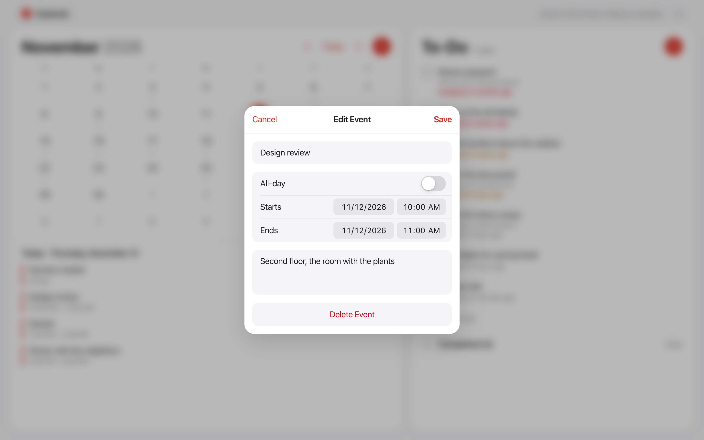
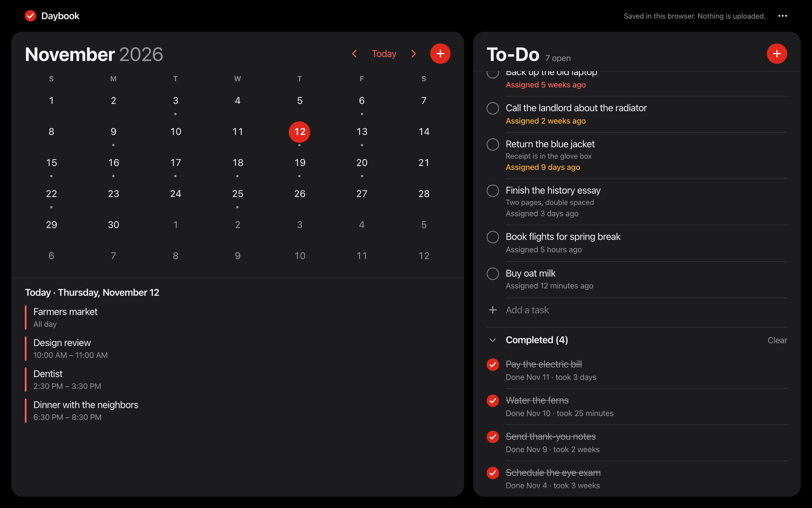
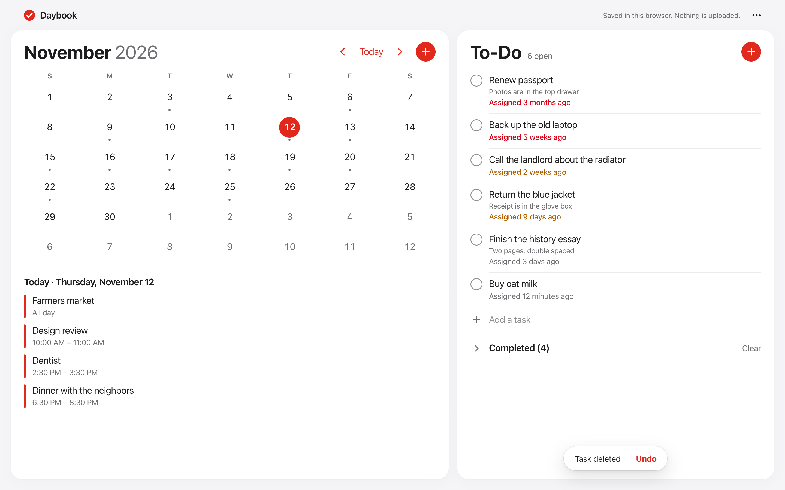

# Daybook

A calendar and a to-do list, nothing else. Every task on the list shows how long it has been waiting.

**Live site: <https://brucesweater.github.io/daybook/>**

To look around with sample data first, open <https://brucesweater.github.io/daybook/?demo>. The sample data is
fictional, lives in memory only and is never saved.



<p>
  
  
  
  
</p>

<table>
  <tr>
    <td></td>
    <td></td>
  </tr>
  <tr>
    <td></td>
    <td></td>
  </tr>
</table>

Everything in these screenshots is the site's own fictional `?demo` data, shown on Thursday, November 12, 2026.

## What it does

- **Calendar.** A month grid that keeps the same height every month, one dot on days that have events, and the
  selected day's agenda underneath. Change month with the ‹ and › buttons, a swipe, or PageUp and PageDown. `T` goes
  to today and `N` starts a new event.
- **To-Do.** Open tasks are oldest first, so whatever has waited longest stays on top. Each one says how long ago it
  was assigned, updates while the page is open, and turns amber after a week and red after a month. A checked-off
  task moves to Completed, which says when it was done and how long it took.
- **Undo instead of "Are you sure?"** Deleting an event or a task shows Undo for five seconds.
- **Backups.** The `…` menu exports your data to a JSON file and imports it again. The Daybook iOS app uses the same
  format, which is how you move data between the two. They don't sync.

## Your data

Everything is saved in this browser's local storage. Nothing is uploaded: there are no accounts, no servers and no
requests to anywhere else, and the page's content security policy enforces that. Clearing the browser's data for the
site erases it, so export a backup now and then.

## How it's made

Plain HTML, CSS and ES modules in `docs/`, served by GitHub Pages from `main:/docs`. There's no framework and no build
step. [`SPEC.md`](SPEC.md) is the product and design contract that the website and the iOS app share.

| Where | What |
|---|---|
| `docs/js/calendar-day.js`, `grid.js`, `events.js`, `calendar-state.js` | Days, the month grid and the event rules, in whole-day arithmetic with no `Date` maths, so daylight saving can't shift a day |
| `docs/js/wording.js`, `tasks.js`, `format.js` | The exact words: age lines, durations, dates and times |
| `docs/js/gesture.js` | What a swipe means when the finger lifts: how far, how fast, and whether it had stopped |
| `docs/js/schema.js`, `store.js` | The file format, validation, and saving to `localStorage` |
| `docs/js/calendar-view.js`, `todo-view.js`, `event-editor.js`, `task-editor.js`, `backup.js`, `toast.js`, `notices.js`, `sheet.js`, `dialogs.js`, `swipe.js`, `motion.js`, `dom.js`, `app.js` | The interface |
| `docs/sw.js` | A network-first service worker: it opens offline, and never keeps an old version in place of a new one |
| `test/` | The tests and tools, which are never published |
| `screens/` | The screenshots above, made by `npm run screens` |

## Running and testing

```sh
npm install           # playwright-core and axe-core, both dev only. It drives your installed Google Chrome.
npm run serve         # http://127.0.0.1:8123/daybook/ , the same base path as GitHub Pages
npm test              # everything: unit and browser tests in three time zones, then the screenshot matrix
npm run test:unit     # pure logic only, a few seconds
npm run test:e2e      # browser tests; DAYBOOK_TZ picks the time zone
npm run screenshots   # every size, mode and state into test/artifacts/ (narrow it: npm run screenshots -- 390x844 dark)
npm run screens       # the README screenshots in screens/
npm run og            # docs/og.png, the link preview
MONKEY_SEED=7 MONKEY_STEPS=500 node --test test/e2e/monkey.test.mjs   # random interactions; a failure names its seed
node test/make-web-export.mjs   # test/fixtures/web-export.json, through the interface; copy it to the iOS app's Fixtures/
```

`npm test` runs the unit tests and the browser tests under America/Chicago, America/Los_Angeles and Asia/Tokyo, to
catch dates that land a day off on either side of UTC. The browser tests type into date fields key by key, check
accessibility with axe in light and dark on desktop and phone layouts, and fail on any console error or any request
that leaves the site. If you add a file under `docs/js/`, add it to the list in `docs/sw.js` too; a test fails if
you forget.

Moving data to and from the iOS app is tested with real files. `test/fixtures/ios-export.json` is a backup the iOS
app's own export wrote, and the tests import it here through the `…` menu and read it off the screen.
`test/fixtures/web-export.json` is this site's export, made through its interface in Chrome, and the iOS app's tests
import it. Both products refuse the same broken files, such as one that isn't UTF-8 or holds half an emoji, so a
backup one of them takes, the other takes too. The iOS app keeps identical copies of both files.

## Browsers

The site is written for current Safari, Chrome and Firefox, using only features all three support, with fallbacks
where one lags (`100vh` before `100dvh`, `-webkit-backdrop-filter`, Sunday as the first day of the week where the
browser can't say). Native date and time fields look different in each browser by design.

**Only Google Chrome was tested automatically. Safari and Firefox were not automated, and no test ran on a real
iPhone or iPad:** touch, safe areas and phone layouts were checked in Chrome's device emulation.
